# HCI Redesign — Assessment Submission

- **Draft for review**
- **Website:** Personal portfolio redesign
- **Evidence archive:** [`hci-evidence/`](./hci-evidence/)
**Original comparison revision:** Git commit `dc17fb4`

## Introduction

This redesign makes the portfolio easier to scan on desktop and mobile while retaining its dark olive-green palette, monospace identity, existing project content, links, and contact-form backend. It updates the homepage, project cards and detail pages, About content, skill groups, and work history. A new Senior Project page describes the supplied bachelor-project goals and clearly marks the work as ongoing; it does not claim unverified implementation or results.

The original captures come from a separate checkout of commit `dc17fb4`, immediately before the “Webpage overhaul” commit. Final captures come from the local production build. Both were captured at matching **390 × 844 CSS-pixel mobile** and **1440 × 900 CSS-pixel desktop** viewports. Images are authentic full-page PNGs: their widths match the configured CSS viewport and their heights represent the full rendered page. The archived baseline does not contain a Senior Project page, so that new page has final-state screenshots only.

## 1. Gestalt

1. **Proximity — Clearly demonstrated.** Project detail pages group each project’s heading and metadata, introduction, image, technology badges, and explanatory sections. On the Online Examination System page, Backend, Frontend, and Security are separate information cards. VV Bygg’s three existing content groups also use separated sections. Related information is encountered together rather than being matched across distant parts of a page.

2. **Similarity — Clearly demonstrated.** Project cards share image sizing, typography, spacing, borders, surfaces, and the labeled “Se prosjekt” action. The detail pages reuse the same breadcrumb, metadata, technology-badge, and content-card patterns. The repeated styling makes related content recognizable as belonging to the same type.

3. **Continuity — Clearly demonstrated, strongest on desktop.** Each detail page follows the same top-to-bottom sequence: breadcrumb, title and metadata, introduction, image, technologies, grouped details, and related projects. Aligned desktop grids reinforce that reading path; at mobile sizes the content stacks into a predictable vertical sequence.

4. **Figure/Ground — Present, but moderate.** Dark card surfaces and borders distinguish project information from the botanical background. The treatment remains intentionally subdued, so the boundary is visible but less forceful than a high-contrast panel. The paired project-card and detail-page screenshots show this separation on both screen sizes.

5. **Closure — Visible, but worth a final student review.** Beside the robot project’s “På robot-siden” explanation, a small SVG draws interrupted head corners, eyes, a mouth, and an antenna. The facial features suggest the missing contour and make the symbol relevant to the robot content. This is not a closed border or a separate caption panel. The 64 px symbol is legible in the robot detail capture, but its small size makes it a weaker demonstration than a larger, isolated shape; assess it at normal mobile viewing size before claiming it is unequivocal.

## 2. Focus-Attention

6. **Contrast — Clearly demonstrated.** Warm gold highlights the homepage “Les mer om meg” action, the labeled project actions, technology badges, contact labels, focus indicators, and submit button against the dark olive surfaces. The accent helps visitors find important actions. No formal WCAG color-contrast ratio measurement was made.

7. **Size and scale — Clearly demonstrated.** The homepage name and project titles are visually larger than role labels, introductions, section headings, and body copy. This makes the page subject and content hierarchy apparent before visitors read the supporting details.

8. **Whitespace — Demonstrated across both layouts.** Spacing separates the homepage introduction, project grids, skills and work groups, project detail sections, and form controls. Mobile spacing is reduced to keep the pages compact; desktop spacing distinguishes sections without relying on extra ornament.

## 3. Recognition

9. **Icon + text labels — Clearly demonstrated.** Project cards use “Se prosjekt” with an arrow instead of an arrow-only action. Visitors can identify the action without having to infer the icon’s meaning.

10. **Consistent patterns — Clearly demonstrated.** Card and badge treatments repeat across the featured-project area, `/projects/`, and the three existing detail pages. Skill categories and work entries also repeat their own card structure. The Senior Project follows the established project layout and adds an explicit “Under utvikling” status.

11. **Location and field cues — Clearly demonstrated.** Project details provide a “Prosjekter / [project]” breadcrumb and related-project navigation. The mobile menu marks the current route. Contact fields show persistent labels above the inputs, including a textarea for the message, so their purpose does not depend on placeholders.

## 4. 7±2 Rule

12. **Application 1 — Technical skills.** The existing skills are grouped into five named category cards. Visitors can first recognize a domain and then scan its skill details, rather than reading a single uninterrupted list. The five top-level groups are within the commonly used 5–9 example range.

13. **Application 2 — Work experience.** Five consistent cards each group a job’s title, employer, dates, and description. The repeated structure helps visitors scan and compare five recognizable entries.

14. **Application 3 — Robot technologies and concepts.** Python, C++, OpenCV, Arduino, Computer Vision, and Embedded Systems appear together as six visually consistent badges. The bounded six-item group is easy to identify without adding concepts.

These are practical information-grouping choices, not a claim that seven items is a universal or exact limit on working memory.

## Visual evidence

The original and final pairs below use matching CSS viewport widths. The complete route captures and provenance are listed in the [`screenshot index`](./hci-evidence/03-intermediate-development/screenshot-index.md).

### E1 — Homepage: hierarchy, contrast, whitespace, and labeled action

**Mobile — 390 px viewport**

Before:

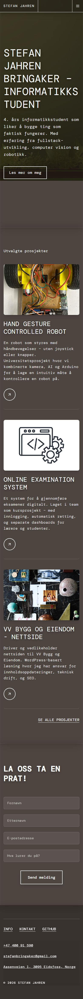

After:

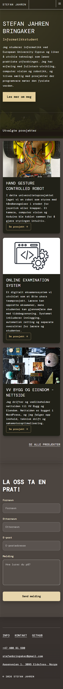

**Desktop — 1440 px viewport**

Before:

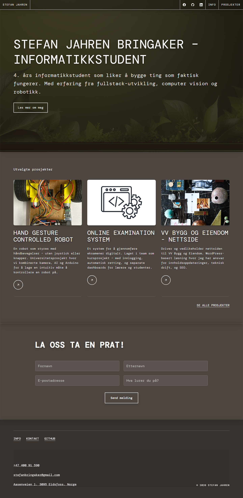

After:

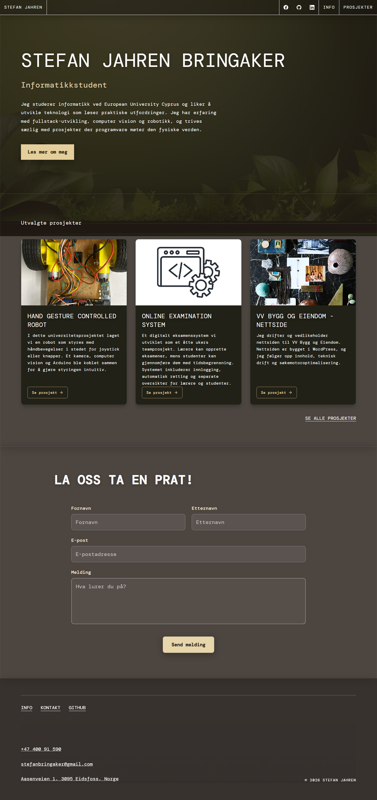

The final homepage capture also shows the persistent contact labels, message textarea, and submit action near the bottom. Earlier phase-specific contact screenshots remain in the intermediate archive; they are historical captures, not substitutes for the final production image.

For a closer comparison of the contact-form redesign, these preserved Phase 5 captures show the form before and after its labels, textarea, spacing, and submit-action changes. They are phase-specific historical evidence; E1 above is the authoritative capture of the current final homepage.

| Viewport | Before Phase 5 | After Phase 5 |
|---|---|---|
| Mobile — 390 × 844 | 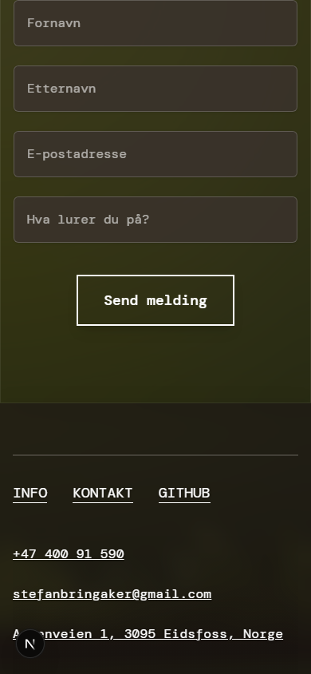 |  |
| Desktop — 1440 × 1000 | 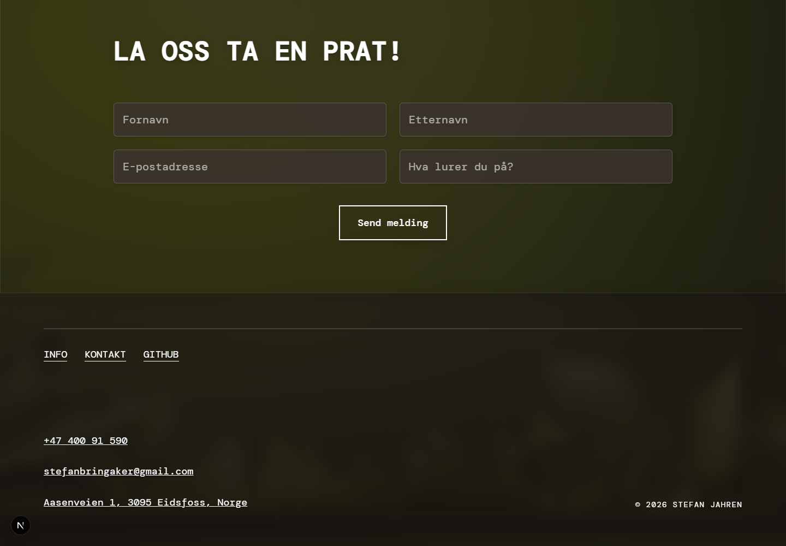 |  |

### E2 — Project cards: proximity, similarity, continuity, figure/ground, and icon + label

**Mobile — 390 px viewport**

Before:

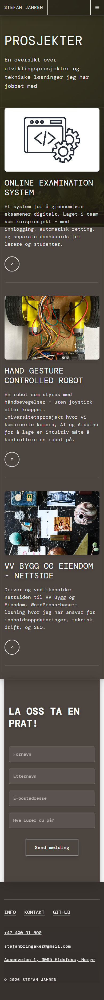

After:

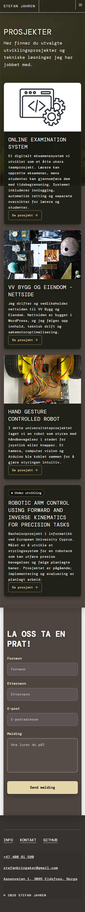

**Desktop — 1440 px viewport**

Before:

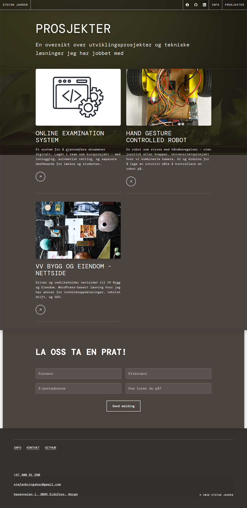

After:

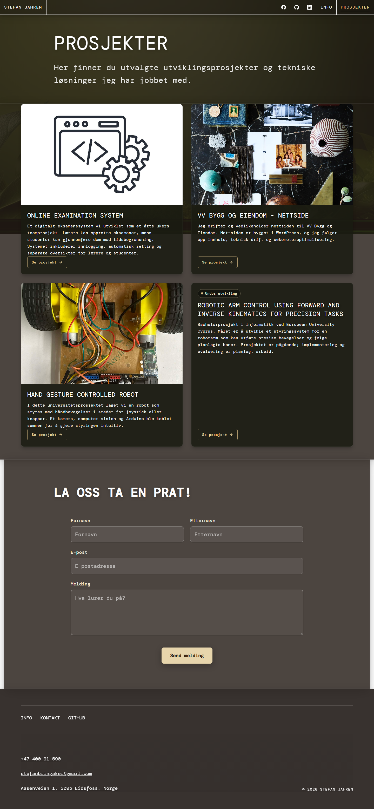

The homepage’s featured-project cards are visible in the paired homepage captures in E1.

### E3 — Skills and work experience: grouping and repeated structure

**Mobile — 390 px viewport**

Before:

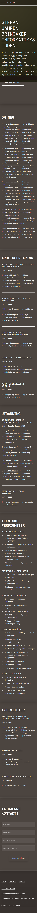

After:

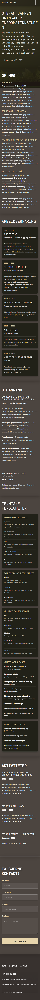

**Desktop — 1440 px viewport**

Before:

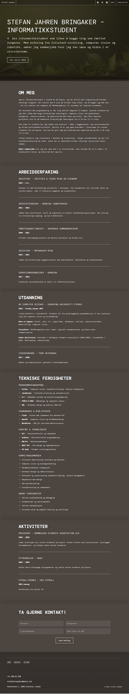

After:

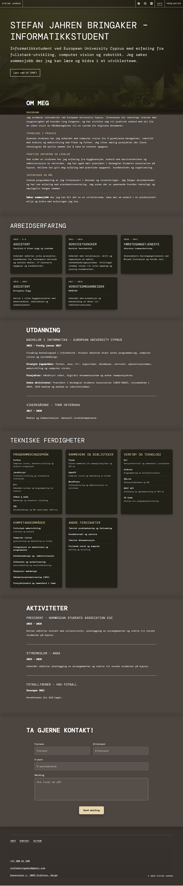

### E4 — Project-detail consistency and Closure

The robot comparison shows the revised detail-page hierarchy, six technology badges, and integrated incomplete robot-face symbol. The symbol is new, so the before capture does not contain a corresponding illustration; it is not presented as a matched before-state of that new feature.

| Viewport | Original project page | Final project page |
|---|---|---|
| Mobile — 390 px | [Original robot detail](./hci-evidence/01-original-website/mobile/robot-mobile-390-fullpage.png) | [Final robot detail](./hci-evidence/02-final-website/mobile/robot-mobile-390-fullpage.png) |
| Desktop — 1440 px | [Original robot detail](./hci-evidence/01-original-website/desktop/robot-desktop-1440-fullpage.png) | [Final robot detail](./hci-evidence/02-final-website/desktop/robot-desktop-1440-fullpage.png) |

Earlier focused screenshots of the robot-side section are retained as supplementary Phase 6 evidence: [mobile](./hci-evidence/03-intermediate-development/phase6-robot-closure-mobile-390.png) · [desktop](./hci-evidence/03-intermediate-development/phase6-robot-closure-desktop-1440.png). They predate the final copy and are not a replacement for the final full-page robot captures above.

The same detail-page structure is visible on these paired captures:

| Project | Mobile — before / after | Desktop — before / after |
|---|---|---|
| Online Examination System | [Before](./hci-evidence/01-original-website/mobile/examination-mobile-390-fullpage.png) · [After](./hci-evidence/02-final-website/mobile/examination-mobile-390-fullpage.png) | [Before](./hci-evidence/01-original-website/desktop/examination-desktop-1440-fullpage.png) · [After](./hci-evidence/02-final-website/desktop/examination-desktop-1440-fullpage.png) |
| VV Bygg og Eiendom | [Before](./hci-evidence/01-original-website/mobile/vv-bygg-mobile-390-fullpage.png) · [After](./hci-evidence/02-final-website/mobile/vv-bygg-mobile-390-fullpage.png) | [Before](./hci-evidence/01-original-website/desktop/vv-bygg-desktop-1440-fullpage.png) · [After](./hci-evidence/02-final-website/desktop/vv-bygg-desktop-1440-fullpage.png) |

The additional Senior Project page has no baseline counterpart: [mobile final capture](./hci-evidence/02-final-website/mobile/senior-project-mobile-390-fullpage.png) · [desktop final capture](./hci-evidence/02-final-website/desktop/senior-project-desktop-1440-fullpage.png).

## Project-image and copy limitations

- **VV Bygg og Eiendom:** The project card displays a collage while the detail page displays a rainy-window photograph. These assets are not established as authentic depictions of the described work. No replacement was made; an authentic, owner-approved project screenshot or image is needed.
- **Online Examination System:** The card illustration and code photograph are not verified as artifacts from the student project. No replacement was made; use an approved image and remove any student data before publication.
- **Blog posts:** Seven generic posts contain Lorem Ipsum/template English copy and a quote attributed to another person. They were preserved pending owner-provided content rather than rewritten with invented facts.
- **About page:** The summer-employment wording may be outdated and needs the owner’s confirmation.
- **Senior Project:** Available project material did not verify implementation, tests, or results. The page presents these as undocumented or future work, not completed accomplishments.

## Technical checks and remaining issues

- `tsc --noEmit` passed.
- `npm run build` passed for the original baseline and the final working tree. The existing dependency warning reports Next.js 15.5.11 with `@next/swc` 15.5.7; no dependency changes were made.
- Seven final routes were checked at 375, 390, 768, 900, 1366, and 1440 CSS px (42 route/viewport combinations). Each returned HTTP 200; document and body widths did not exceed the viewport, and no development overlay appeared.
- Desktop navigation and its social links were visible from 768 through 1440 px; the hamburger was hidden at those widths. There was no horizontal overflow or overlap.
- The mobile menu was checked open and closed at 390 px, including its active-route marker, Escape-to-close, and focus restoration. Its three social links each have a 64 × 64 px clickable area.
- Contact labels and message textarea were checked without submitting the form. No real message or email was sent.
- The final source includes older placeholder blog content and the two unverified image choices listed above; these remain open owner decisions.

## Conclusion

The portfolio implements all 14 requested HCI applications with visible examples across mobile and desktop layouts. Grouping, repeated card patterns, reading order, visual hierarchy, and recognition cues are documented against the actual interface rather than generic definitions. Figure/Ground is present but subdued, and the small Closure symbol merits a final human judgment at normal viewing size. The project imagery, blog filler, and potentially stale employment copy also require owner review. The site and evidence are prepared for review only; nothing has been deployed.

## AI-use disclosure

An AI coding assistant helped implement and review the website changes, organize the screenshot archive, run local validation, and draft this document. The screenshots are real captures of the local website and were not AI-generated or edited. Project facts were limited to existing portfolio content and the supplied Senior Project brief. The portfolio owner should verify personal facts, project descriptions, image permissions, and this disclosure against institutional requirements before submission.
